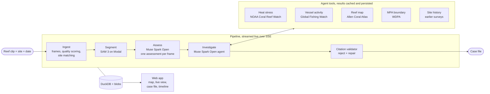

<p align="center">
  <a href="https://app2732006--reefcase-api-api.us-east.modal.run"><b>Open the live app</b></a>
  &nbsp;·&nbsp;
  <a href="docs/media/tour.mp4">Watch the 42-second tour</a>
  &nbsp;·&nbsp;
  <a href="#how-it-works">How it works</a>
  &nbsp;·&nbsp;
  <a href="#evaluation">Evaluation</a>
</p>

<p align="center">
  Team <b>Yours Truly</b> · Meta Global AI Developer Hackathon, Oct 26–Nov 4, 2026<br>
  Built with Muse Spark Open and SAM 3. Powered by Global Fishing Watch.
</p>

<br>

A marine park manager gets a number: "coral cover down 20%". ReefCase gives them a case. Upload a
reef clip, pin the dive site and set the date. Minutes later there is a case file that says what
happened to the reef, which causes the data supports and which it rules out, with every claim
linked to the frame or the dataset it came from.

## See it work

<!--
  Inline player: on github.com, edit this file and drag docs/media/tour.mp4 into the editor.
  GitHub uploads it and inserts a https://github.com/user-attachments/assets/... URL on its own
  line, which renders as a video player. Put that line here, above the GIFs.
-->

<table>
<tr>
<td width="50%" valign="top">

<p><b>The site.</b> Every monitored reef on one map. HAW-41 opens on its NOAA survey history since
2013 and the new dive, split frame by frame into live coral, bleached coral, algae, rubble, sand
and other.</p>
</td>
<td width="50%" valign="top">

<p><b>The case file.</b> Muse Spark Open writes a verdict and competing hypotheses with
confidences. Open any citation to see the frame, or the exact query and result the agent got
back from NOAA Coral Reef Watch.</p>
</td>
</tr>
</table>

<sub>Real-time screen capture of the live deployment, not a mock-up. Two page loads are cut. The
2024 "dive" is stitched from that station's NCRMP survey photos (see <a href="#how-it-works">the
demo site</a>).</sub>

## The problem

Coral reefs are bleaching faster than scientists can survey them. A survey today means a trained
diver photographing a transect and a scientist annotating every image by hand for hours.
Meanwhile millions of recreational divers film reefs every year, and that footage is never used.

Even when a decline is measured, nobody connects it to a cause. Heat stress, anchor damage and
fishing inside no-take zones leave different signatures, but the evidence sits in separate
systems: ocean temperature products, satellite vessel detections, reef maps and survey photos.
Marine park managers get a number ("coral cover down 20%"), not a case they can act on.

## What ReefCase does

Upload a reef clip, pin the dive site and set the date. ReefCase:

1. **Surveys** the clip: it splits every usable frame into live coral, bleached coral, algae,
   rubble, sand and other, and estimates cover.
2. **Compares** the result with earlier surveys of the same site.
3. **Investigates**: an agent pulls heat stress, vessel activity, reef map and protected-area
   data for that site and time window.
4. **Concludes** with a case file: findings, competing hypotheses with confidences, a verdict and
   recommended actions.

Every claim in the case file cites a frame or a tool result. A claim without a valid citation
is rejected and repaired before anyone sees it. Clicking a finding opens the evidence drawer on
the exact frame or data record.

## How it works



Each stage streams to the browser over SSE as it runs, so the live view fills in frame by frame
and tool call by tool call. The agent's tool results are cached and stored with the survey, which
is why every citation still opens to the data the agent actually saw.

<details>
<summary><b>Full architecture diagram</b></summary>



</details>

- **Backend:** Python 3.14, FastAPI, pydantic-ai, DuckDB with the spatial extension. Code is in
  [src/reefcase/](src/reefcase/).
- **Web:** React 19, Vite, TanStack Router and Query, Tailwind 4, deck.gl with MapLibre. Code is
  in [web/](web/).
- **ML:** SAM 3 pseudo-labelling, ReefStudent training and eval, and the Modal apps. Code is in
  [ml/](ml/).
- **Demo site:** NOAA NCRMP station HAW-41 (West Hawaii), with surveys from 2013, 2016 and 2019
  plus a 2024 "new dive". The 2024 demo clip isn't diver video: it is stitched from that
  station's 2024 NCRMP survey photos by
  [scripts/build_demo_clip.py](scripts/build_demo_clip.py).

## Meta models and how we use them

We use open-weight Meta models only.

| Model | Where | What it does |
|---|---|---|
| **SAM 3** (`facebook/sam3`, Transformers) | Modal T4 endpoint ([ml/modal/sam_endpoint.py](ml/modal/sam_endpoint.py)) | Text-prompted segmentation of each frame into the six reef classes (`REEFCASE_SEGMENTER=sam3_modal`). It is also the teacher that pseudo-labelled the training frames for the distilled ReefStudent. |
| **Muse Spark Open** (`meta-models/muse-spark-open-1026`, Baseten) | Frame assessor ([src/reefcase/llm/assess.py](src/reefcase/llm/assess.py)) | Reads each frame together with its segmentation and returns a bleaching severity (0–4), coral growth forms, physical damage and short notes. |
| **Muse Spark Open** | Investigator agent ([src/reefcase/agent/investigator.py](src/reefcase/agent/investigator.py)) | A pydantic-ai agent that calls the five tools, weighs the evidence and writes the cited case file. |
| **Muse Spark Open** | Teacher dataset ([ml/modal/gen_assessments.py](ml/modal/gen_assessments.py)) | Produced 3,366 frame assessments of Coralscapes images (about $13 on Baseten) as training data for fine-tuning Muse Glimmer as a fast frame assessor. |

Muse Spark Open has no JSON mode on Baseten, so every structured output goes through a tool call.
It is a reasoning model, so reasoning effort is pinned per role to keep a run inside the latency
budget. Every model is configured through `REEFCASE_LLM_*` and `REEFCASE_SEGMENTER` env vars, so
switching provider needs no code change.

## Evaluation

### ReefStudent vs SAM 3

ReefStudent is a U-Net (EfficientNet-B0) segmenter that we trained on Coralscapes. All three
models were scored on the same held-out 392-frame Coralscapes test split, mapped to the six
classes.

| Model | Test mIoU | ms per frame (T4) |
|---|---|---|
| **ReefStudent, supervised (shipped)** | **0.683** | **161** |
| ReefStudent, distilled from SAM 3 | 0.291 | 161 |
| SAM 3 (teacher) | 0.300 | 1,247 |

ReefStudent beats SAM 3 on every class at about 8× the speed. Distilling from SAM 3 alone only
matches the teacher, so the student trained on human labels is the one we kept. The training
data, per-class IoU, speeds and known failure modes are in
[ml/results/MODEL_CARD.md](ml/results/MODEL_CARD.md). The raw numbers are in
[ml/results/eval.json](ml/results/eval.json).

The benchmark win didn't carry over to our demo site. On the 2024 HAW-41 clip, ReefStudent read
46% live coral, where SAM 3, the 2013–2019 history and the Muse Spark Open assessor all put it at
about 5%. Given that contradiction, the investigator kept calling tools until it hit the request
limit. So live uploads segment with SAM 3, and ReefStudent segments the historical surveys in
the seed. `REEFCASE_DISAGREEMENT_CHECK` runs SAM 3 next to ReefStudent on every frame. Where
their coral masks overlap by less than 0.5 IoU, it keeps the SAM 3 mask and flags the frame as
uncertain in the case file.

### Teacher assessments

Muse Spark Open assessed 1,683 Coralscapes train and val frames, as left and right halves (3,366
rows). It never saw the test split. Severity spread: 2,362 rows at 0 (none), 670 at 1, 182 at 2,
84 at 3 and 68 at 4. Summary: [ml/results/assessments_summary.json](ml/results/assessments_summary.json).

<!-- TODO(8.3): end-to-end time for the 60 s demo clip on the deployment (NFR1), from the re-timed SAM 3 run -->

## Run it yourself

<details>
<summary><b>Running locally</b></summary>

You need [uv](https://docs.astral.sh/uv/) and [pnpm](https://pnpm.io/).

```bash
uv sync                       # add --group gpu for real SAM 3 / ReefStudent weights
pnpm -C web install
cp .env.example .env          # fill in the values you need
```

The defaults run offline: `REEFCASE_SEGMENTER=fake` needs no GPU or keys. For real runs, set the
segmenter (`student`, `sam3_modal` or `sam3_local`) and the `REEFCASE_LLM_*` endpoints. Any
OpenAI-compatible endpoint works. `.env.example` lists every variable.

```bash
# API only
uv run uvicorn --factory reefcase.api.main:create_app

# API + web app on one origin
pnpm -C web build
REEFCASE_WEB_DIST=web/dist uv run uvicorn --factory reefcase.api.main:create_app
```

Then open http://localhost:8000.

</details>

<details>
<summary><b>Tests</b></summary>

```bash
uv run poe gate               # ruff, format, pyright strict, import-linter, pytest
pnpm -C web run gate          # typecheck, oxlint, vitest, playwright
```

Tests run offline. HTTP calls replay from cassettes, and models are replaced by fakes. Tests
marked `gpu` or `live` are skipped by the gate.

</details>

<details>
<summary><b>Deploying</b></summary>

The API runs as a Modal ASGI app ([ml/modal/api_app.py](ml/modal/api_app.py)) that serves the
built web app on 2 CPUs and segments live uploads with SAM 3 on its own Modal GPU endpoint, a
separate app. The seed segments the historical surveys with ReefStudent on CPU. The Modal secret
`reefcase` holds the `.env` keys.

```bash
pnpm -C web build
PYTHONUTF8=1 uv run --with modal modal run ml/modal/api_app.py::seed
PYTHONUTF8=1 uv run --with modal modal deploy ml/modal/api_app.py
```

</details>

<details>
<summary><b>Rebuilding the README media</b></summary>

The hero and pipeline graphics are generated, not drawn: every frame, mask, tool result and
hypothesis in them comes from the HAW-41 survey on the live deployment. The tour is recorded against the live app.

```bash
uv run python scripts/readme_media/build_svgs.py <cache_dir> <fonts_dir>   # see its docstring
node scripts/readme_media/record_tour.mjs     # then the ffmpeg steps in its header
```

</details>

## Built during the hackathon (Oct 26–Nov 4)

Everything in this repository was written during the hackathon. The first commit
(`4207fe3`, Oct 26) holds the plan and no product code: the PRD, the architecture and the story
list in [planning/planning-artifacts/](planning/planning-artifacts/), plus the
coding-agent setup we built the project with. Every component below was built after it, story
by story. Progress is tracked in
[sprint-status.yaml](planning/implementation-artifacts/sprint-status.yaml).

- **Core:** schemas, IDs and events; env-only settings and the model provider factory; the
  DuckDB and blob store; test fixtures and fakes.
- **Ingest:** the survey upload endpoint; the job runner, event bus and SSE stream; frame
  extraction; quality scoring with fail-fast; site matching.
- **Vision:** the segmenter interface and cover computation; the local SAM 3 backend; the
  bleached vs live coral split; SAM 3 on Modal; the segmentation stage.
- **Tools:** the tool framework and result cache; heat stress (NOAA Coral Reef Watch); vessel
  activity (Global Fishing Watch); reef map and MPA boundary (Allen Coral Atlas, WDPA); site
  history; the map layer and site endpoints.
- **Agent:** the Muse Spark Open frame assessor; the investigator agent; the citation validator
  and repair loop; the investigate stage and report persistence.
- **Web:** the scaffold, generated API client and event reducer; the upload page; the live
  investigation view; the reef map; the case file with the evidence drawer; the site timeline.
- **ML:** the training corpus and SAM 3 pseudo-labels; ReefStudent training (supervised and
  distilled); evaluation against human labels; the ReefStudent backend in the app; the
  3,366-row Muse Spark Open assessment dataset.
- **Data and ops:** the NCRMP historical survey import for HAW-41; the demo clip builder; the
  Modal deployment.

Third-party libraries, models and datasets are listed with their licences below. They are used,
not modified.

## Data and licences

ReefCase uses data from Global Fishing Watch, NOAA Coral Reef Watch and NCRMP, the Allen Coral
Atlas, WDPA and Coralscapes. Some of these sources are licensed for non-commercial use only. The
models are SAM 3 and Muse Spark Open. See [data/LICENSES.md](data/LICENSES.md) for each source's
licence and attribution.

Built with Muse Spark Open. Powered by Global Fishing Watch.
