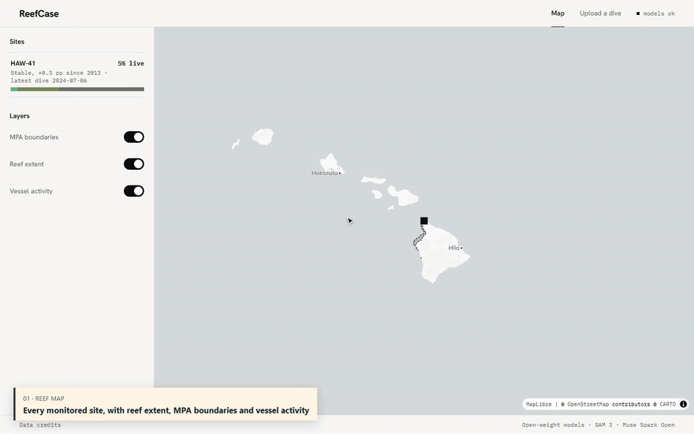
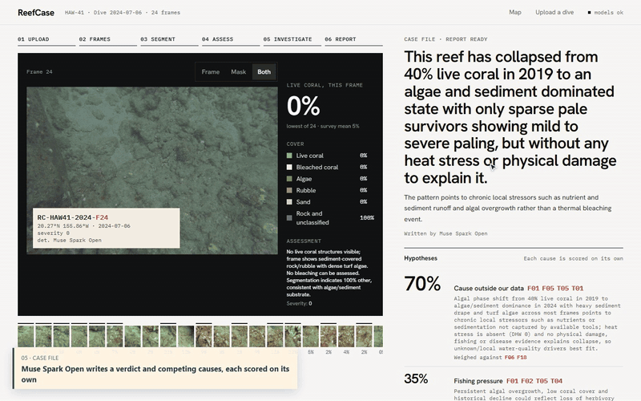

<p align="center">
  <a href="https://app2732006--reefcase-api-api.us-east.modal.run"><b>Open the live app</b></a>
  &nbsp;·&nbsp;
  <a href="docs/media/tour.mp4">Watch the 42-second tour</a>
  &nbsp;·&nbsp;
  <a href="#how-it-works">How it works</a>
  &nbsp;·&nbsp;
  <a href="#two-segmenters-that-check-each-other">Evaluation</a>
</p>

<p align="center">
  Team <b>Yours Truly</b> · Meta Global AI Developer Hackathon, Oct 26–Nov 4, 2026<br>
  Built with Muse Spark Open and SAM 3. Powered by Global Fishing Watch.
</p>

<br>

A marine park manager gets a number: "coral cover down 20%". ReefCase gives them a case. Upload a
reef clip, pin the dive site and set the date. About three minutes later there is a case file that
says what happened to the reef, which causes the data supports and which it rules out, with every
claim linked to the frame or the dataset it came from.

## See it work

<table>
<tr>
<td width="50%" valign="top">

<p><b>The site.</b> HAW-41's NOAA survey history since 2013, and the new dive split frame by
frame into live coral, bleached coral, algae, rubble, sand and other.</p>
</td>
<td width="50%" valign="top">

<p><b>The case file.</b> A verdict and competing causes. Open any citation to see the frame, or
the exact query and result the agent got back from NOAA Coral Reef Watch.</p>
</td>
</tr>
</table>

<sub>Screen capture of the live deployment, not a mock-up. The 2024 "dive" is stitched from that
station's NCRMP survey photos.</sub>

## Why it matters

Reefs are bleaching faster than scientists can survey them, while millions of recreational divers
film reefs every year and the footage goes unused. Even when a decline is measured, nobody ties it
to a cause: heat stress, anchor damage and fishing inside no-take zones leave different
signatures, but the evidence sits in separate systems.

ReefCase segments every usable frame, compares the cover with earlier surveys of the site, and
sends an agent through heat stress, vessel activity, reef map and protected-area data for that
place and time. Every claim in the case file must cite a frame or a tool result. A claim without
a valid citation is rejected and repaired before anyone sees it.

## How it works

<picture>
  <source media="(prefers-color-scheme: dark)" srcset="docs/media/pipeline-dark.svg">
  
</picture>

Each stage streams to the browser as it runs, so the live view fills in frame by frame and tool
call by tool call. Tool results are stored with the survey, so every citation opens to the data the
agent actually saw. On the deployment, a 24-frame clip goes from upload to case file in 183 s.

**Stack:** Python 3.14, FastAPI, pydantic-ai and DuckDB ([src/reefcase/](src/reefcase/)) · React 19,
Vite, TanStack and deck.gl ([web/](web/)) · SAM 3 and ReefStudent on Modal ([ml/](ml/)).

## Meta models and how we use them

We use open-weight Meta models only.

| Model | Where | What it does |
|---|---|---|
| **SAM 3** (`facebook/sam3`) | Modal T4 endpoint ([ml/modal/sam_endpoint.py](ml/modal/sam_endpoint.py)) | Text-prompted segmentation of each frame into six reef classes. Also the teacher that pseudo-labelled training frames for ReefStudent. |
| **Muse Spark Open** (Baseten) | Frame assessor ([src/reefcase/llm/assess.py](src/reefcase/llm/assess.py)) | Reads each frame with its segmentation and returns a bleaching severity (0–4), growth forms, damage and notes. |
| **Muse Spark Open** | Investigator agent ([src/reefcase/agent/investigator.py](src/reefcase/agent/investigator.py)) | Calls the five data tools, weighs the evidence and writes the cited case file. |
| **Muse Spark Open** | Teacher dataset ([ml/modal/gen_assessments.py](ml/modal/gen_assessments.py)) | 3,366 frame assessments of Coralscapes images, as training data for a fast Muse Glimmer frame assessor. |

## Two segmenters that check each other

ReefStudent is a U-Net (EfficientNet-B0) we trained on Coralscapes. All models were scored on the
same held-out 392-frame test split.

| Model | Test mIoU | ms per frame (T4) |
|---|---|---|
| **ReefStudent, supervised** | **0.683** | **161** |
| ReefStudent, distilled from SAM 3 | 0.291 | 161 |
| SAM 3 (teacher) | 0.300 | 1,247 |

ReefStudent wins the benchmark at 8× the speed, but the win didn't transfer to our Hawaiian demo
site: it read 46% live coral where SAM 3, the site's history and the assessor all put it near 5%.
So live uploads segment with SAM 3, and the disagreement check runs both models on every frame:
where their coral masks overlap by less than 0.5 IoU, the case file keeps the SAM 3 mask and flags
the frame as uncertain. Details are in [ml/results/MODEL_CARD.md](ml/results/MODEL_CARD.md).

## Run it yourself

<details>
<summary><b>Running locally</b></summary>

You need [uv](https://docs.astral.sh/uv/) and [pnpm](https://pnpm.io/).

```bash
uv sync                       # add --group gpu for real SAM 3 / ReefStudent weights
pnpm -C web install
cp .env.example .env          # fill in the values you need
pnpm -C web build
REEFCASE_WEB_DIST=web/dist uv run uvicorn --factory reefcase.api.main:create_app
```

Then open http://localhost:8000. The defaults run offline with no GPU or keys
(`REEFCASE_SEGMENTER=fake`). `.env.example` lists every variable for real runs.

</details>

<details>
<summary><b>Tests</b></summary>

```bash
uv run poe gate               # ruff, format, pyright strict, import-linter, pytest
pnpm -C web run gate          # typecheck, oxlint, vitest, playwright
```

Tests run offline: HTTP calls replay from cassettes and models are replaced by fakes.

</details>

## Built during the hackathon

Everything here was written between Oct 26 and Nov 4. The first commit (`4207fe3`) holds only the
plan: the PRD, architecture and story list in
[planning/planning-artifacts/](planning/planning-artifacts/). Every component was built
after it, story by story, as tracked in
[sprint-status.yaml](planning/implementation-artifacts/sprint-status.yaml).

## Data and licences

ReefCase uses data from Global Fishing Watch, NOAA Coral Reef Watch and NCRMP, the Allen Coral
Atlas, WDPA and Coralscapes. Some sources are licensed for non-commercial use only. Third-party
libraries, models and datasets are used, not modified. See [data/LICENSES.md](data/LICENSES.md)
for each source's licence and attribution.
